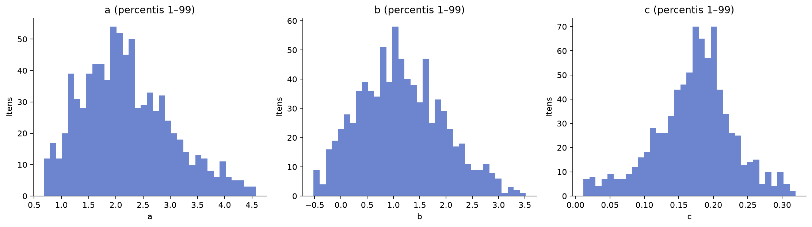
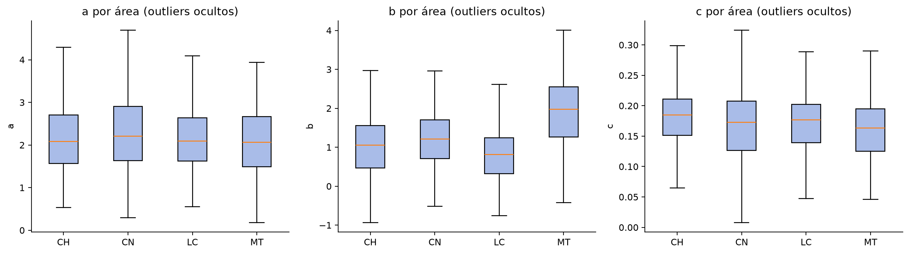
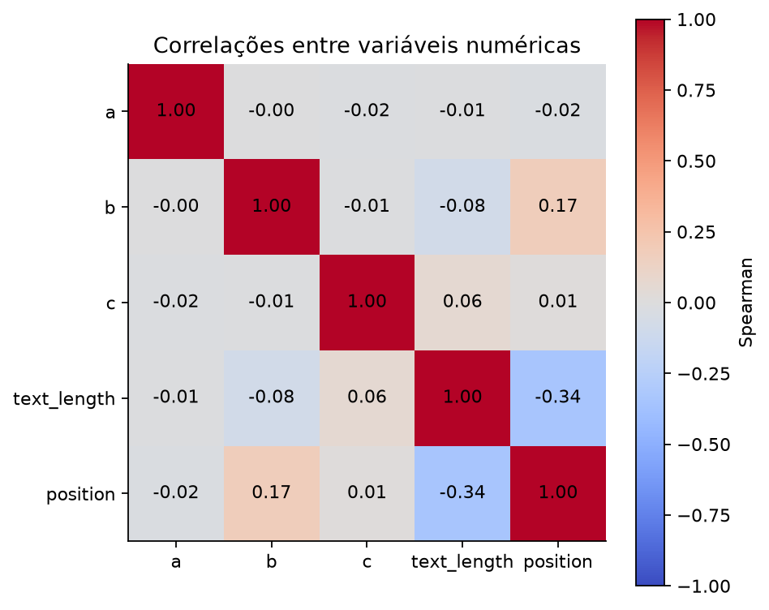
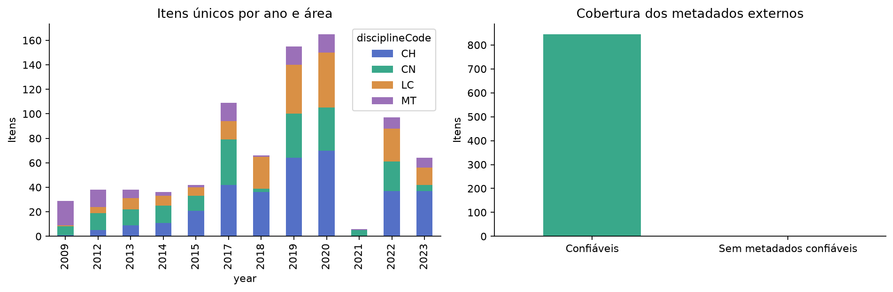
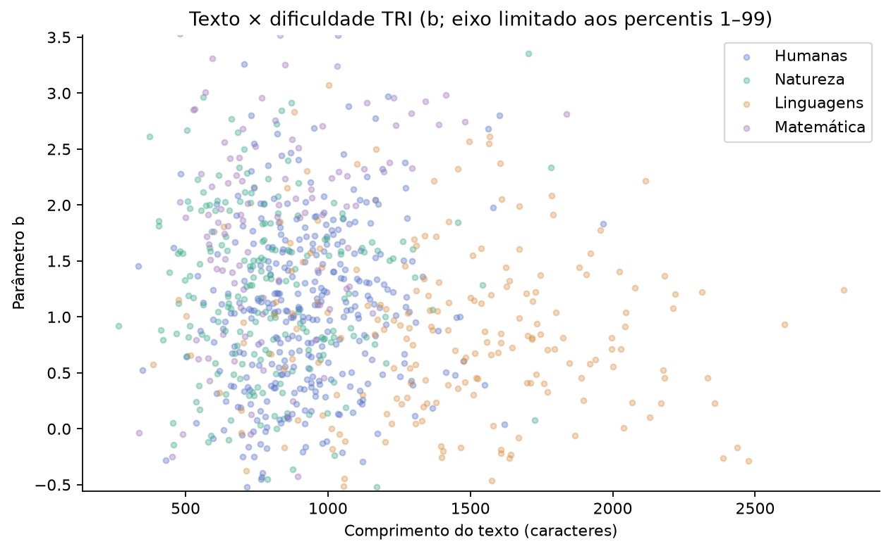
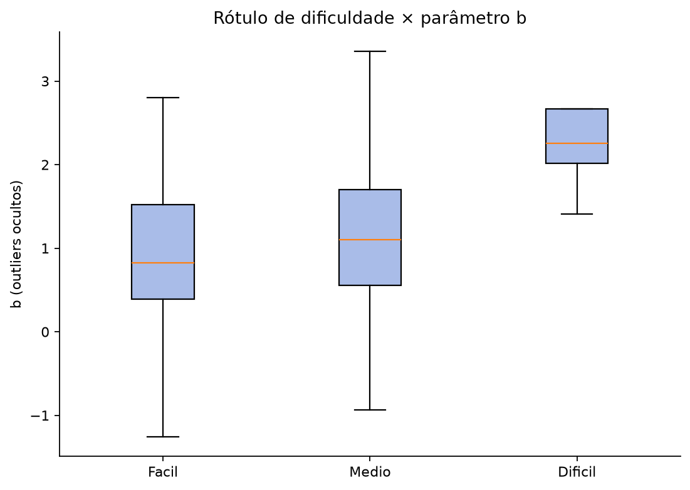

# Análise exploratória do dataset TRI

Fonte: `dados/processados/dataset_com_embeddings.csv`. Linhas originais: 936; pareamentos exact: 846; itens únicos analisados: 845.

## Distribuição dos parâmetros

| Parâmetro | Mediana | Média | Desvio padrão | P1 | P99 | Mínimo | Máximo |
|---|---:|---:|---:|---:|---:|---:|---:|
| a | 2.103 | 2.213 | 0.892 | 0.676 | 4.596 | 0.183 | 6.734 |
| b | 1.085 | 1.157 | 0.942 | -0.558 | 3.520 | -1.707 | 12.417 |
| c | 0.176 | 0.172 | 0.061 | 0.011 | 0.321 | 0.002 | 0.412 |

## Correlações exploratórias

| Par | n | Pearson | p Pearson | Spearman | p Spearman |
|---|---:|---:|---:|---:|---:|
| a_vs_b | 845 | -0.047 | 0.169 | -0.002 | 0.953 |
| a_vs_c | 845 | 0.052 | 0.128 | -0.019 | 0.582 |
| b_vs_c | 845 | 0.018 | 0.592 | -0.013 | 0.698 |
| text_length_vs_a | 845 | -0.019 | 0.580 | -0.013 | 0.707 |
| text_length_vs_b | 845 | -0.096 | 0.005 | -0.078 | 0.023 |
| text_length_vs_c | 845 | 0.033 | 0.335 | 0.061 | 0.075 |

## Por área

| Área | n | Mediana b | Spearman texto × b |
|---|---:|---:|---:|
| Humanas (CH) | 333 | 1.052 | 0.146 |
| Natureza (CN) | 205 | 1.213 | -0.019 |
| Linguagens (LC) | 197 | 0.814 | -0.049 |
| Matemática (MT) | 110 | 1.975 | 0.289 |

## Qualidade e interpretação

- Metadados confiáveis em 845 de 845 itens (100.0%).
- Rótulos de dificuldade disponíveis: {'Medio': 747, 'Facil': 94, 'Dificil': 4}.
- Pearson é sensível a valores extremos; consulte Spearman e os percentis antes de interpretar.
- Os gráficos de distribuição e dispersão limitam a visualização aos percentis 1–99; as estatísticas e correlações usam todos os valores.
- Valores p são descritivos: há múltiplas comparações e não foi feita correção para elas.
- Correlação não demonstra previsão fora do ENEM nem calibração TRI em simulados externos.

## Imagens

