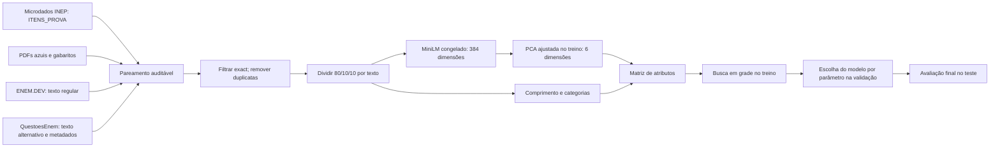

# Estimativa preliminar de parâmetros da Teoria de Resposta ao Item a partir de textos de questões do ENEM

**Disciplina:** Tendências em Inteligência Computacional  
**Docente:** Prof. Dr. Rodrigo Gabriel Ferreira Soares  
**Autores:** Fábio Filho e Henrique  
**Tema do projeto:** Calibração automatizada de questões com base na TRI para banco de questões

## Resumo

Este estudo investiga a possibilidade de estimar preliminarmente os parâmetros de discriminação (`a`), dificuldade (`b`) e acerto casual (`c`) da Teoria de Resposta ao Item (TRI) com base no texto de questões do Exame Nacional do Ensino Médio (ENEM). Foram pareados parâmetros oficiais dos microdados do Inep com textos da API ENEM.DEV e, subsidiariamente, de uma coleção local de questões revisadas. Após filtragem de correspondências confirmadas e remoção de duplicatas, obtiveram-se 2.061 itens únicos. As questões foram representadas por embeddings produzidos por um transformer multilíngue pré-treinado, combinados com atributos estruturais e pedagógicos. Sete famílias de regressores e duas referências estatísticas foram avaliadas mediante uma divisão agrupada de treino, validação e teste de aproximadamente 80%, 10% e 10%. A seleção de hiperparâmetros ocorreu por validação cruzada no treino, e a escolha final de cada estimador baseou-se no erro absoluto médio da validação. Na amostra de teste, o SVR selecionado para `a` obteve MAE de 0,7954; as referências por área e global foram selecionadas para `b` e `c`, com MAE de 0,7958 e 0,0502, respectivamente. Os resultados indicam que, neste protocolo, a representação textual não ofereceu ganho preditivo consistente frente a referências simples. As saídas devem ser interpretadas como estimativas exploratórias, e não como calibração psicométrica equivalente àquela realizada com respostas de participantes.

**Palavras-chave:** Teoria de Resposta ao Item; ENEM; processamento de linguagem natural; embeddings; regressão; avaliação de modelos.

> **Nota de reprodutibilidade:** o documento descreve a execução local de 12/11/2026, registrada em `dados/modelos/`. Uma nova execução pode alterar as contagens, os hiperparâmetros selecionados e as métricas; nesses casos, as tabelas devem ser atualizadas antes da submissão.

## 1. Introdução

O Exame Nacional do Ensino Médio (ENEM) é uma avaliação de grande escala. Segundo a apresentação de resultados do Inep, a edição de 2023 teve **4.018.414 inscritos** e **2.734.100 participantes**. O Inep disponibiliza microdados, provas, gabaritos e informações sobre os itens. Portanto, existe uma fonte pública para ligar o texto de uma questão aos parâmetros do item, embora essa ligação dependa de identificar corretamente a edição, o caderno, a posição e o código da prova. Fontes: [resultados oficiais do ENEM 2023](https://download.inep.gov.br/enem/resultados/2023/apresentacao_resultados.pdf) e [microdados do ENEM](https://www.gov.br/inep/pt-br/acesso-a-informacao/dados-abertos/microdados/enem).

O ENEM usa um modelo logístico da Teoria de Resposta ao Item (TRI) com três parâmetros. Para proficiência `θ`, a probabilidade de acerto é representada por:

```text
P(acerto | θ, a, b, c) = c + (1 − c) / (1 + exp[−a(θ − b)])
```

`a` representa discriminação, `b` dificuldade e `c` a assíntota inferior associada ao acerto casual. Os valores oficiais são estimados a partir de padrões de respostas; **não são propriedades que o texto, isoladamente, determine com exatidão**. Veja a [descrição técnica do Inep sobre a análise TRI](https://download.inep.gov.br/publicacoes/institucionais/avaliacoes_e_exames_da_educacao_basica/enem_procedimentos_de_analise.pdf).

Assim, formula-se a seguinte **questão de pesquisa**: em que medida a representação textual obtida por um codificador neural pré-treinado, combinada com área e metadados pedagógicos, permite estimar os parâmetros oficiais `a`, `b` e `c` de itens não utilizados no ajuste? Em particular, investiga-se se essa abordagem supera a média histórica dos parâmetros por área.

O objetivo geral consiste em construir e avaliar um procedimento reproduzível de estimativa preliminar dos três parâmetros. Como objetivos específicos, pretende-se: (i) construir uma base auditável que associe textos e parâmetros oficiais; (ii) comparar representações com e sem embeddings; (iii) selecionar modelos e hiperparâmetros sem consultar o conjunto de teste; e (iv) delimitar a utilidade prática das estimativas obtidas. A aplicação potencial é a triagem inicial de questões externas antes da coleta de respostas. Sua utilização como parâmetro calibrado dependeria de validação psicométrica e de ligação à escala desejada.

## 2. Trabalhos relacionados

Marinho et al. (LAK 2023) investigaram a previsão de parâmetros TRI de itens do ENEM a partir dos enunciados. Utilizando uma arquitetura neural e um objetivo associado à curva característica do item, relataram erro absoluto médio de aproximadamente 70 pontos para a dificuldade `b` em questões de 2020 e 2021. Em outro contexto, o [BERT-IRT de Yancey et al. (BEA 2024)](https://aclanthology.org/2024.bea-1.35/) combina embeddings BERT e atributos linguísticos para reduzir a necessidade de pré-testes no Duolingo English Test. Esses trabalhos demonstram a relevância da informação textual, mas também evidenciam a necessidade de protocolos de avaliação compatíveis com o exame e a escala de interesse. O presente estudo contribui com um **procedimento local e auditável de pareamento e comparação com referências estatísticas**; não reivindica originalidade na previsão de parâmetros TRI por texto. Seus resultados não são diretamente comparáveis aos dos estudos citados em razão de diferenças de dados, escala, divisão e função objetivo. Fontes: [anais LAK 2023](https://www.solaresearch.org/events/lak/lak23/table-of-contents/) e [BERT-IRT](https://aclanthology.org/2024.bea-1.35/).

## 3. Materiais e métodos

### 3.1. Fontes de dados e construção do conjunto

As etiquetas `a`, `b` e `c` vêm das colunas `NU_PARAM_A`, `NU_PARAM_B` e `NU_PARAM_C` das tabelas oficiais `ITENS_PROVA` dos microdados. O código extrai os PDFs azuis e usa ano, dia, área, posição, gabarito e `CO_PROVA` para formar candidatos de pareamento. Candidatos incertos são marcados como `ambiguous` e **não entram no treino**. O gabarito oficial pode verificar a associação de `CO_PROVA` com o caderno.

Para o texto, a prioridade é **ENEM.DEV** quando a questão é da aplicação regular e a correspondência por ano e número impresso também passa nas verificações de área, gabarito e cinco alternativas. Se a API não trouxer o item, a pasta local `QuestoesEnem` pode fornecer texto revisado quando o cruzamento por aplicação, ano, área, resposta e similaridade das alternativas for confirmado. O texto extraído dos PDFs serve ao pareamento; textos apenas extraídos e sem confirmação não alimentam o modelo. A base local também fornece `assunto`, `competencia`, `habilidade` e `dificuldade` quando o pareamento é confiável. O campo `dificuldade` é um rótulo pedagógico externo e seu modo de atribuição precisa ser auditado antes de interpretar qualquer ganho como previsão independente do parâmetro `b`.

Na execução documentada, o CSV com embeddings continha **2.378 linhas**: 1.949 com texto ENEM.DEV e 429 com texto de `QuestoesEnem`. Após exigir `matchQuality=exact`, texto e três rótulos completos, origem confirmada e remoção de duplicatas por `CO_ITEM` e texto normalizado, restaram **2.061 itens únicos**: 1.635 com texto da API e 426 da pasta local. Esses itens cobrem anos entre **2009 e 2023**, mas **não todos os anos**: 2010, 2011 e 2016 não aparecem no conjunto final. Essas contagens descrevem esta execução, não todos os itens publicados pelo Inep.

### 3.2. Representação dos itens e famílias de modelos

Cada questão reúne enunciado/contexto e alternativas. O encoder neural pré-treinado [`paraphrase-multilingual-MiniLM-L12-v2`](https://huggingface.co/sentence-transformers/paraphrase-multilingual-MiniLM-L12-v2) produz **384 números por texto**. O encoder é usado **congelado, somente para inferência**; não houve ajuste fino do transformer. A entrada padrão do treinamento reduz esses vetores a **6 componentes de PCA**, ajustada apenas no conjunto de treino externo. Soma-se o comprimento do texto padronizado e codificação one-hot de área, assunto, competência, habilidade e dificuldade. Ano e posição não entram como preditores, pois não são atributos naturais de uma questão externa inédita.

Foram comparados: regressão Ridge, Elastic Net, regressão Bayesiana, Huber, SGD com perda Huber, SVR com kernel RBF e um perceptron multicamadas (MLP) com parada antecipada. O **MLP é a rede neural treinada supervisionadamente** neste estudo; o MiniLM é uma rede profunda pré-treinada usada como extrator fixo de características. As referências de controle são a média global de cada parâmetro no treino e a média por área. Esses controles são necessários para verificar se a representação textual acrescenta informação além da área da prova.

### 3.3. Fluxo de processamento



O procedimento computacional é resumido pelo seguinte pseudocódigo, correspondente à implementação atual:

```text
itens = parear_textos_e_parametros_oficiais()
itens = filtrar_origem_confirmada_e_match_exact(itens)
itens = remover_duplicatas_por_CO_ITEM_e_texto(itens)
treino, validacao, teste = dividir_por_grupo_de_texto(itens, 80/10/10)
vetores = MiniLM_congelado(textos)                 # 384 dimensões
PCA, scaler, one_hot = ajustar_no_treino(vetores, metadados)
X = concatenar(PCA(vetores), scaler(comprimento), one_hot(categorias))
para cada familia de modelo:
    buscar hiperparametros por GroupKFold(3) apenas no treino
    ajustar melhor configuracao no treino
    medir MAE por parametro na validacao
escolher, para cada a/b/c, o menor MAE de validacao entre modelos e baselines
avaliar os escolhidos no teste uma vez
ajustar artefato final nos 2.061 itens para inferencia posterior
```

## 4. Delineamento experimental e seleção dos modelos

### 4.1. Hipóteses e objetivos dos experimentos

1. O texto codificado pelo MiniLM melhora a previsão frente aos atributos categóricos isolados.
2. A melhor dimensão reduzida do embedding pode variar entre `a`, `b` e `c`.
3. A busca de hiperparâmetros e a escolha por validação podem superar os baselines sem consultar o teste.
4. A rede neural MLP pode captar relações não lineares que modelos lineares não captam, mas pode generalizar pior numa base pequena.

### 4.2. Particionamento, controle de vazamento e métricas

A divisão padrão usa `GroupShuffleSplit` com 10% para teste (`random_state=42`) e, dos 90% restantes, `1/9` para validação (`random_state=43`). Nesta execução: **1.648 treino, 206 validação e 207 teste**. Os grupos são textos normalizados; textos duplicados são previamente removidos. A proporção é aproximada porque os grupos devem permanecer íntegros. Há uma opção separada de avaliação por anos inteiros, mas **os números aqui apresentados são da divisão aleatória agrupada**, não de teste temporal.

A PCA, a padronização do comprimento e o vocabulário one-hot são ajustados no conjunto de treino externo. A busca em grade usa `GroupKFold(3)` **somente dentro desses 1.648 itens**. O critério da busca é o **MAE médio entre `a`, `b` e `c` após dividir o erro de cada alvo pelo seu desvio-padrão no treino**, evitando que as escalas diferentes dominem a escolha. Cada família recebe uma configuração ótima conjunta. Depois, a **validação externa escolhe separadamente** o menor MAE para `a`, `b` e `c`, incluindo os dois baselines; o teste mede a combinação selecionada. O mesmo teste não é usado para alterar a grade.

**Limite metodológico da implementação atual:** os transformadores de atributos são ajustados no treino externo antes das três dobras internas. Logo, as dobras internas compartilham informação não supervisionada da PCA, do scaler e do vocabulário one-hot. A validação e o teste externos permanecem fora desse ajuste, mas uma validação cruzada interna estritamente isolada exigiria ajustar os transformadores dentro de cada dobra. O documento não atribui à busca em grade uma independência de dobra que o código ainda não oferece.

As métricas registradas são **MAE** (erro absoluto médio), **RMSE** (raiz do erro quadrático médio) e **R²** (variância explicada no teste). O arquivo de validação registra MAE. Os erros de `a` e `b` estão nas unidades brutas das respectivas colunas do microdado; `c` é uma probabilidade. Não se deve comparar diretamente MAE de parâmetros diferentes nem converter o MAE de `b` em pontos da nota ENEM sem transformação de escala validada. O MLP usa `early_stopping=True`; o pipeline **não salva curvas por época nem histórico do erro de treinamento**. Assim, o monitoramento verificável neste estudo é por CV, validação externa e teste final, não por curvas de aprendizagem.

### 4.3. Espaço de busca e justificativa dos estimadores

| Família | Papel no estudo | Valores testados | Melhor configuração na CV desta execução |
|---|---|---|---|
| Ridge | Referência linear regularizada para muitos atributos correlacionados | `alpha`: 0,1; 1; 10; 100 | `alpha=100` |
| Elastic Net | Seleção e regularização de atributos | `alpha`: 0,001; 0,01; 0,1 × `l1_ratio`: 0,2; 0,7 | `alpha=0,1`, `l1_ratio=0,2` |
| MLP | Testar não linearidade com uma rede neural pequena | camadas `(64,)` ou `(128,64)` × `alpha`: 0,001; 0,1 | `(64,)`, `alpha=0,1` |
| SVR RBF | Testar relação não linear com margem | `C`: 0,5; 2; 10 × `epsilon`: 0,05; 0,2 | `C=0,5`, `epsilon=0,05` |
| Bayesian Ridge | Regularização linear probabilística | `alpha_1` e `lambda_1`: 10⁻⁶ ou 10⁻⁴ cada | `alpha_1=10⁻⁶`, `lambda_1=10⁻⁴` |
| Huber | Regressão menos sensível a valores extremos | `epsilon`: 1,35; 1,75 × `alpha`: 0,0001; 0,1 | `epsilon=1,75`, `alpha=0,1` |
| SGD Huber | Ajuste linear rápido com perda robusta | `alpha`: 10⁻⁵; 10⁻⁴; 10⁻³ × penalidade `l2` ou `elasticnet` | `alpha=10⁻⁵`, `penalty=l2` |

Ao todo: **34 combinações**, cada uma em três dobras. Valores não listados permanecem nos defaults explicitados em `python/treinar_modelo.py` ou nos defaults da biblioteca. Modelos com uma saída por alvo usam `MultiOutputRegressor`; o MLP e o Ridge recebem as três saídas diretamente. A busca usa um objetivo conjunto, portanto a melhor configuração de uma família pode não ser a melhor configuração possível para um parâmetro isolado. Os arquivos auditáveis são `dados/modelos/grid_search_resultados.csv` e `dados/modelos/melhores_hiperparametros.json`.

### 4.4. Estudos de ablação

- **Com e sem embeddings:** mesmos itens e mesma divisão; a variante sem embeddings conserva comprimento e categorias, enquanto a outra adiciona a PCA do MiniLM. Arquivos: `dados/modelos/estudo_embeddings/metricas.csv` e `comparacao_teste.csv`.
- **Dimensão dos embeddings:** PCA de **6, 125, 245 e 364** posições nos mesmos **2.061 itens**, com as mesmas divisões e atributos auxiliares. Arquivos: `dados/modelos/estudo_dimensoes/metricas_todas_dimensoes.csv`, `itens_e_divisao.csv` e relatório da pasta.
- **Importância por permutação:** os grupos de atributos são embaralhados na validação para medir alteração do MAE; isso descreve uso pelo modelo, não efeito causal.

**Nota para comparar estudos:** as ablações de dimensão foram executadas com hiperparâmetros fixos da versão de `python/comparar_embeddings.py`, enquanto o resultado principal abaixo é da busca em grade de `python/treinar_modelo.py`. Não apresentar a melhor dimensão da ablação como se tivesse sido selecionada pela mesma busca em grade. A escolha de dimensão pelo teste também seria vazamento; o relatório da ablação seleciona pela validação.

## 5. Resultados

### 5.1. Desempenho após a busca em grade

| Parâmetro | Escolhido pelo menor MAE na validação | MAE validação | MAE teste | RMSE teste | R² teste | Baseline por área: MAE teste |
|---|---|---:|---:|---:|---:|---:|
| `a` | SVR RBF | 0,7155 | 0,7954 | 1,0321 | −0,0350 | 0,7980 |
| `b` | Baseline por área | 0,6356 | 0,7958 | 1,5813 | 0,0813 | 0,7958 |
| `c` | Média global | 0,0540 | 0,0502 | 0,0652 | −0,0011 | 0,0494 |

Fonte interna: `dados/modelos/metricas_validacao.csv` e `dados/modelos/metricas.csv`. O teste contém **207 itens**. Para `a`, o SVR foi selecionado por uma pequena vantagem na validação, mas no teste ficou praticamente empatado com a média por área e apresentou R² negativo. Para `b`, nenhum regressor superou a média por área na **validação**; a escolha foi o baseline. Para `c`, a média global venceu por diferença mínima na validação; no teste a média por área teve MAE ligeiramente menor, mas **não deve substituir retroativamente** o modelo escolhido. Esse exemplo mostra por que a seleção não pode olhar o teste.

Os resultados desta divisão não oferecem evidência de ganho preditivo consistente da representação textual para os três parâmetros. Em particular, a média por área obteve o menor MAE de validação para `b`. Valores de R² próximos de zero ou negativos indicam capacidade explicativa reduzida, segundo a métrica quadrática, em relação a uma previsão constante calculada no próprio conjunto avaliado. No teste, o MLP obteve `MAE(a)=0,8411`, `MAE(b)=0,8312` e `MAE(c)=0,0584`, sem apresentar o melhor desempenho em nenhum dos alvos. A inferência limita-se à amostra, aos filtros e ao particionamento empregados; não estabelece impossibilidade geral de prever parâmetros TRI a partir do texto.

O estudo de dimensão, com modelos de hiperparâmetros fixos, também não apresentou ganho consistente. Ele escolheu pela validação: `a` com 364 dimensões e SGD Huber (MAE teste 0,8057; R² −0,0666), `b` com 125 dimensões e SGD Huber (MAE teste 0,8575; R² 0,0234) e `c` com 364 dimensões e Elastic Net (MAE teste 0,0498; R² 0,0103). O salto de MAE de `b` entre validação (0,6385) e teste (0,8575) sugere sensibilidade à amostra. Fonte interna: `dados/modelos/estudo_dimensoes/relatorio.md`.

## 6. Discussão

### 6.1. Custo computacional e aplicabilidade

O maior custo de preparação é vetorizar os textos pelo MiniLM; os vetores são guardados e reutilizados. PCA e modelos lineares são relativamente baratos para cerca de dois mil itens; SVR e MLP custam mais. A grade requer **102 ajustes em dobras** (34 × 3), além do reajuste das melhores configurações e do artefato final. O código usa `n_jobs=1`, evitando paralelismo de múltiplos ajustes; tempo e RAM variam com o computador, e não foram cronometrados de forma controlada. O MLP usa parada antecipada. Não há evidência registrada para afirmar uma duração exata em minutos.

O módulo de inferência recebe uma questão externa e retorna estimativas e uma faixa relativa de dificuldade. Todavia, ainda não se mediu seu erro em simulados externos com parâmetros calibrados na mesma escala. Como a seleção atual utiliza a média por área para `b` e a média global para `c`, essas duas saídas principais podem permanecer constantes para diferentes questões de uma mesma área. Em consequência, a aplicação plausível neste estágio é a **triagem exploratória e a análise metodológica**; o sistema não oferece base empírica para atribuição de parâmetros TRI oficiais nem para o cálculo válido de notas de estudantes.

### 6.2. Interpretação dos achados e ameaças à validade

O texto traz conteúdo e forma, mas os parâmetros TRI também refletem respostas de uma população e a relação do item com sua proficiência. Figuras, gráficos e tabelas podem conter informação decisiva que um encoder somente textual não recebe. O conjunto com 2.061 itens é pequeno para ajustar uma rede profunda de ponta a ponta, e a passagem de 384 números para poucas componentes de PCA pode descartar sinais úteis. Metadados incompletos ou subjetivos também podem limitar generalização. Essas são **hipóteses explicativas coerentes com o problema e com os resultados**, não causas demonstradas isoladamente pelos experimentos atuais.

Entre as ameaças à validade, destacam-se a divisão aleatória por texto, que não reproduz necessariamente a previsão de uma edição futura; a ausência de informação visual em itens com figuras; a possibilidade de erro residual no pareamento; a origem potencialmente subjetiva de metadados pedagógicos; e o ajuste dos transformadores de atributos fora das dobras internas da validação cruzada. Tais fatores devem ser considerados na interpretação dos resultados, sem que se atribua isoladamente a qualquer um deles a diferença de desempenho observada.

## 7. Conclusão e trabalhos futuros

A principal contribuição do estudo é a construção verificável do conjunto de dados e sua avaliação frente a referências simples. No protocolo examinado, os modelos que utilizaram o texto não superaram consistentemente os baselines para os três parâmetros e, portanto, não substituem a calibração fundamentada em respostas de participantes. A questão de pesquisa foi respondida **para a base, os filtros e a divisão avaliados**: há viabilidade técnica para gerar estimativas, mas não evidência suficiente de precisão para uso operacional como parâmetros calibrados.

Propõem-se os seguintes trabalhos futuros, em ordem de prioridade:

1. Reservar anos inteiros recentes para teste e repetir a avaliação em várias divisões, com intervalo de confiança para a diferença de MAE contra o baseline.
2. Auditar o rótulo externo `dificuldade` para verificar se foi definido com acesso ao parâmetro TRI ou à taxa de acertos; se houver essa origem, excluí-lo de experimentos de previsão independente.
3. Reajustar PCA, scaler e one-hot dentro de cada dobra da busca; fazer busca específica por alvo em vez de uma única métrica conjunta.
4. Tratar texto e imagem de questões multimodais; testar ajuste fino controlado de encoder e comparar com o MiniLM congelado, preservando a divisão por item.
5. Avaliar questões externas com respostas de estudantes, calibrar nelas os parâmetros na mesma escala e medir erro, ordenação de dificuldade e impacto na curva TRI antes de qualquer uso operacional.

## Referências e materiais de reprodução

As fontes externas utilizadas são: [Inep, resultados do ENEM 2023](https://download.inep.gov.br/enem/resultados/2023/apresentacao_resultados.pdf); [Inep, microdados do ENEM](https://www.gov.br/inep/pt-br/acesso-a-informacao/dados-abertos/microdados/enem); [Inep, procedimentos de análise TRI](https://download.inep.gov.br/publicacoes/institucionais/avaliacoes_e_exames_da_educacao_basica/enem_procedimentos_de_analise.pdf); [Marinho et al., LAK 2023](https://www.solaresearch.org/events/lak/lak23/table-of-contents/); [Yancey et al., BEA 2024](https://aclanthology.org/2024.bea-1.35/); e [documentação do modelo MiniLM multilíngue](https://huggingface.co/sentence-transformers/paraphrase-multilingual-MiniLM-L12-v2). A revisão bibliográfica ampliada encontra-se em `docs/REVISAO_LITERATURA_TRI_TEXTO.md`; as métricas de versões anteriores ali citadas não substituem os artefatos da execução descrita neste texto.

### Procedimento de reprodução

O treinamento principal pode ser reproduzido por:

```bash
python -m python.treinar_modelo \
  --csv dados/processados/dataset_com_embeddings.csv \
  --out dados/modelos
```

Para reconstruir o fluxo completo a partir dos dados locais já extraídos e dos arquivos da API em cache:

```bash
python -m python.main --skip-api-download --include-ambiguous --color AZUL
```

Os módulos centrais são `python/montar_dataset_tri.py`, `python/sincronizar_api_enem.py`, `python/enriquecer_dataset_questoes.py`, `python/tokenizar_dataset.py`, `python/treinar_modelo.py`, `python/comparar_embeddings.py` e `python/estudar_dimensoes_embeddings.py`. Os principais artefatos são `dados/processados/dataset_com_embeddings.csv` e os relatórios de `dados/modelos/`.

## Apêndice A. Organização da apresentação oral (20 minutos)

| Tempo | Conteúdo | Evidência/visual sugerido |
|---:|---|---|
| 0–3 min | Definir TRI e explicar `a`, `b`, `c` e a pergunta de pesquisa | Curva característica do item do [Inep](https://download.inep.gov.br/publicacoes/institucionais/avaliacoes_e_exames_da_educacao_basica/enem_procedimentos_de_analise.pdf) |
| 3–5 min | Motivação e literatura | Tabela de Marinho et al. e BERT-IRT; explicitar a diferença de protocolo |
| 5–9 min | Fontes e pareamento, incluindo rejeição de ambiguidades | Fluxograma desta seção e uma linha auditável do dataset |
| 9–13 min | MiniLM, PCA, MLP, baselines e lógica da busca em grade | Esquema 384 → 6 + categorias → CV → validação → teste |
| 13–17 min | Tabela principal e ablações | Tabela desta seção; gráfico `dados/modelos/estudo_dimensoes/mae_por_dimensao.png` |
| 17–20 min | Limitações, conclusão e próximos passos | Três mensagens: `b` baseline, `a/c` fracos, precisa de respostas externas |

Recomenda-se que ambos os integrantes dominem o pareamento, a função do MiniLM congelado, a distinção entre validação cruzada, validação externa e teste, e a interpretação de um baseline vencedor. A distribuição de falas deve ser definida pelo grupo e ensaiada com cronômetro.

### Questões prováveis da arguição

- **“Isso é aprendizagem profunda?”** O MiniLM é um transformer profundo pré-treinado que gera embeddings; o MLP é treinado no projeto. O transformer não foi ajustado para TRI e não venceu a seleção atual.
- **“Por que `b` saiu por área?”** A seleção foi pelo menor MAE na validação. A média por área teve 0,6356, melhor que os regressores considerados nesta execução. No teste, seu MAE foi 0,7958.
- **“A API e os microdados estão em relação um para um?”** Não por pressuposto universal. O pipeline confere ano, número, área, gabarito, aplicação e qualidade do pareamento; só pares confirmados e `exact` são treinados. Nem todas as questões e anos chegam ao conjunto final.
- **“Por que não comparar diretamente com os 70 pontos de Marinho?”** Nossa `b` é a coluna bruta usada no pipeline, com outro conjunto e outra divisão; a comparação requer mesma escala e mesmo protocolo.
- **“Qual a principal ameaça à validade?”** O teste aleatório agrupado pode ser mais fácil que prever um ano futuro ou outra plataforma; também há informação visual ausente e incerteza na origem de alguns metadados.

